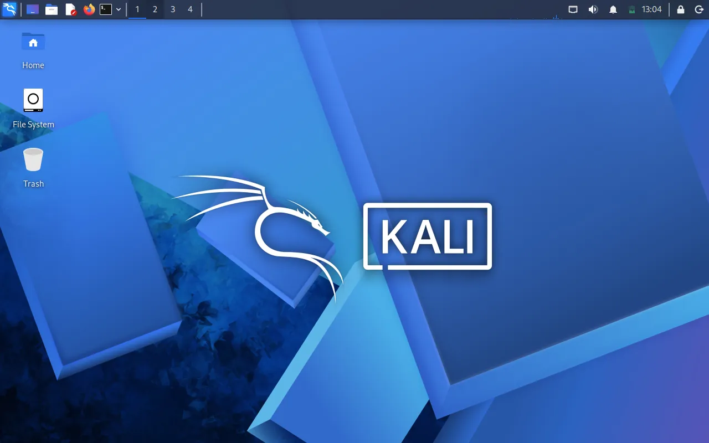
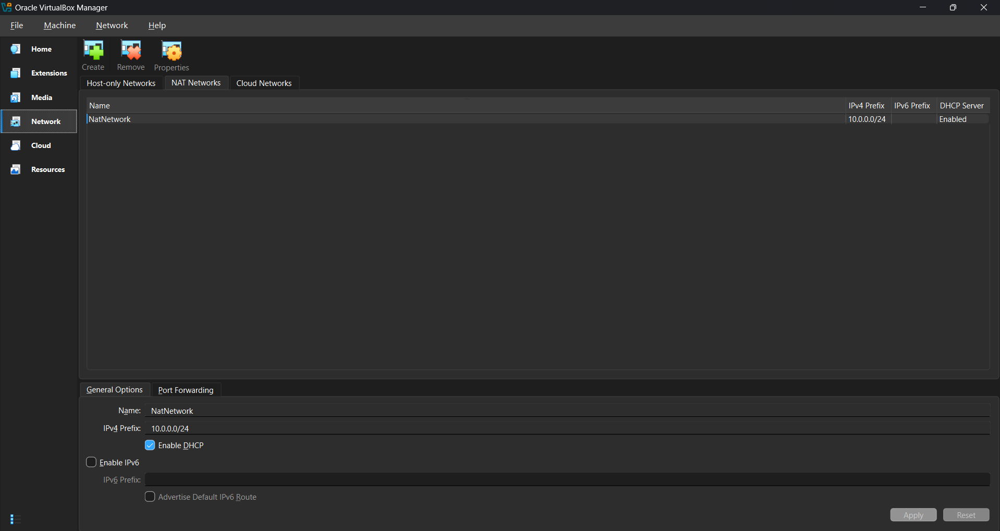
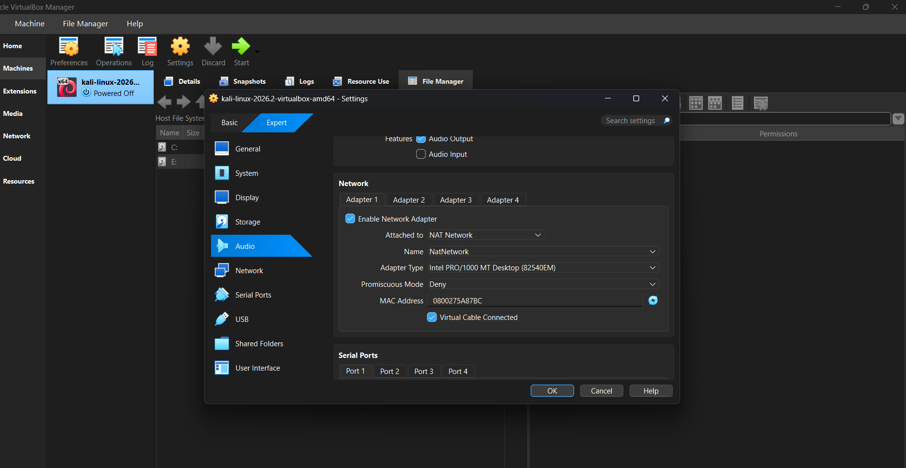
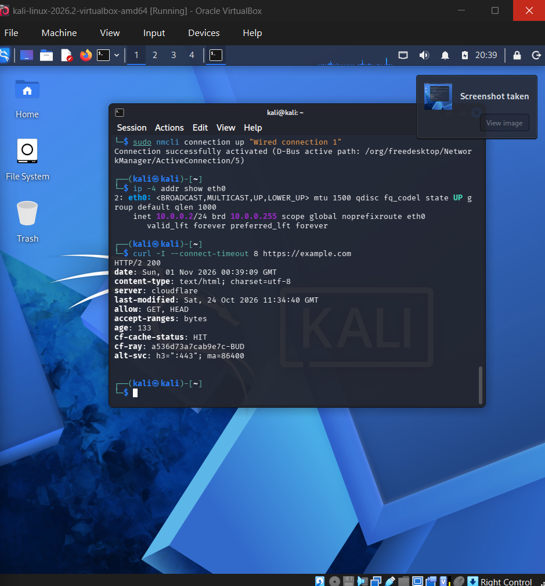
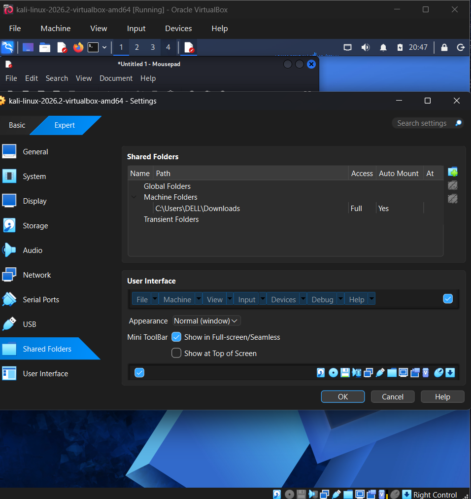
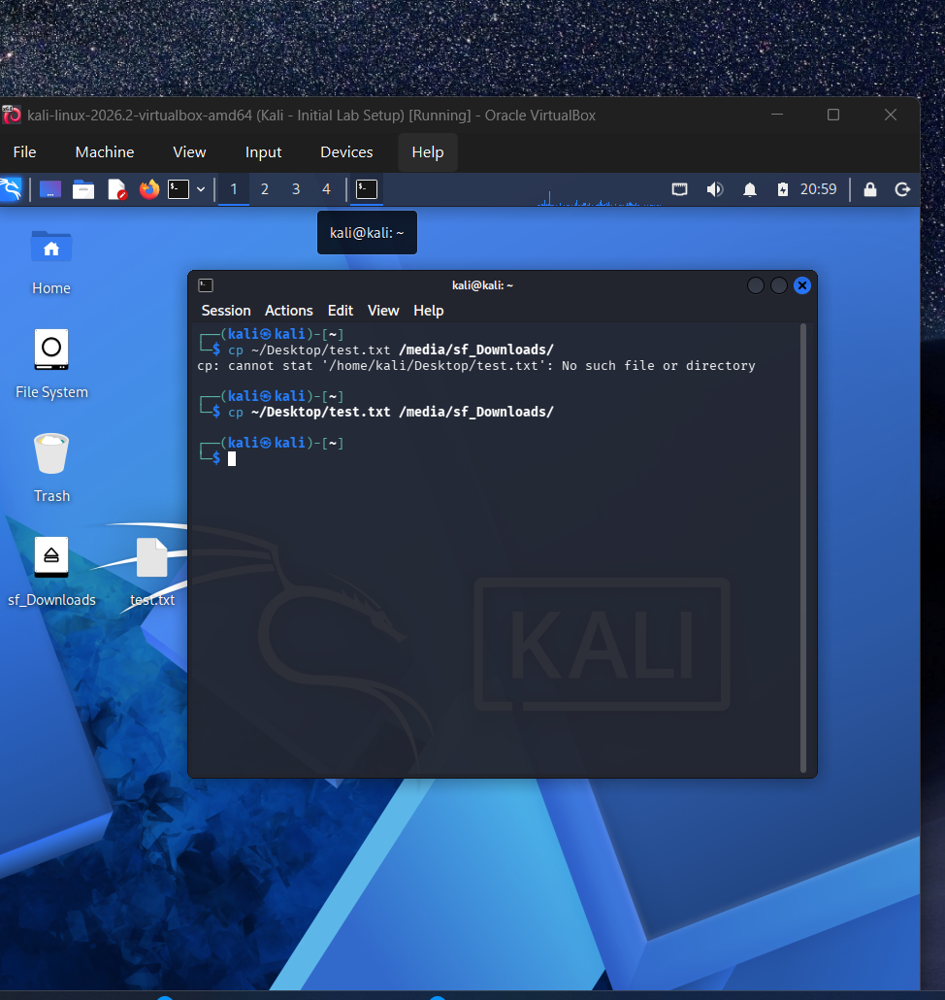
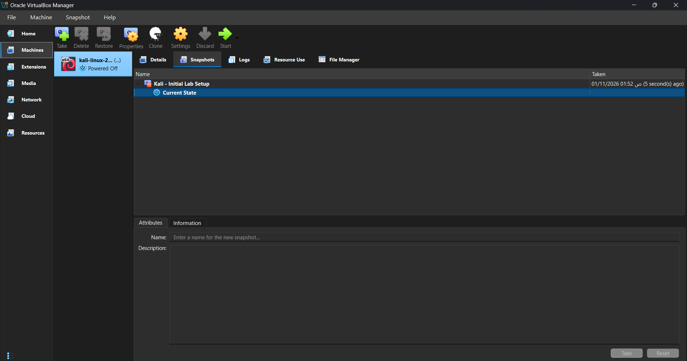

# Cybersecurity Lab Setup — Week 1

**Networkwalks Cybersecurity Internship | Project Module 1**

## Project Overview

This was my first practical project in the Networkwalks Cybersecurity Internship.

The goal was to set up a virtual lab using Oracle VirtualBox and Kali Linux. This environment will be used for cybersecurity practice and future security testing exercises.

During the setup, I configured the virtual network, assigned a static IP address, tested internet connectivity, enabled file sharing, and created a snapshot of the working machine.

## Tools Used

* Oracle VirtualBox
* Kali Linux 2026.2
* Windows 11 (Host OS)
* 7-Zip

## 1. Setting Up VirtualBox and Kali Linux

I started by installing Oracle VirtualBox on my Windows computer.

After that, I downloaded the pre-built Kali Linux virtual machine from the official Kali website, extracted the files, and added the machine to VirtualBox.

I initially experienced some problems while booting Kali Linux, including a black screen and graphics-related error messages. After troubleshooting the virtual machine settings, I was able to start Kali successfully.

## 2. Network Configuration

The next step was creating a NAT Network in VirtualBox.

I used the following configuration:

| Setting         | Value                  |
| --------------- | ---------------------- |
| Network Name    | NatNetwork             |
| Network Type    | NAT Network            |
| Network Prefix  | 10.0.0.0/24            |
| Kali IP Address | 10.0.0.2/24            |
| Default Gateway | 10.0.0.1               |
| DNS Servers     | 8.8.8.8, 1.1.1.1       |
| DHCP            | Enabled on NAT Network |

I connected Kali Linux to this network using Adapter 1.

The machine initially received the IP address `10.0.0.3` through DHCP, but the project required `10.0.0.2`.

I configured a static IP address using NetworkManager.

## 3. Testing Network Connectivity

After configuring the network, I verified the IP address using:

`ip -4 addr show eth0`

The result confirmed that Kali was using:

`10.0.0.2/24`

I also tested connectivity to the virtual gateway:

`ping -c 4 10.0.0.1`

All four packets were received successfully.

Initially, ping requests to `8.8.8.8` failed. However, testing an HTTPS connection using:

`curl -I https://example.com`

returned `HTTP/2 200`.

This confirmed that HTTPS connectivity and DNS resolution were working.

## 4. Clipboard and File Sharing

I enabled the following settings in VirtualBox:

* Shared Clipboard: Bidirectional
* Drag and Drop: Bidirectional
* Shared Folder: Windows Downloads directory

I verified that copying and pasting text between Windows and Kali worked.

Dragging files from Windows to Kali also worked, but dragging files in the opposite direction was unsuccessful.

As an alternative, I used the shared folder to transfer files from Kali back to Windows.

The shared directory was accessible inside Kali at:

`/media/sf_Downloads`

I successfully transferred a test file and confirmed that it appeared in Windows Downloads.

## 5. Creating a Snapshot

After completing the configuration, I shut down Kali Linux and created a VirtualBox snapshot.

**Snapshot Name:** `Kali - Initial Lab Setup`

This snapshot allows me to restore the virtual machine to its configured state if something goes wrong during future exercises.

## 6. Challenges and Troubleshooting

I encountered several problems during this project:

**Kali Linux boot issue:** The virtual machine initially displayed graphics-related errors and a black screen. I investigated the display settings before getting Kali to boot.

**Network configuration:** Kali originally received a different IP address. I changed the network configuration to use the required static IP.

**Internet testing:** ICMP requests to an external IP were unsuccessful, but gateway connectivity and HTTPS access worked correctly.

**Drag and Drop:** File transfers from Kali to Windows did not work through direct dragging. I successfully used VirtualBox Shared Folders instead.

These issues helped me become more familiar with VirtualBox configuration and basic Linux troubleshooting.

## 7. What I Learned

Through this project, I gained practical experience with:

* Creating and managing virtual machines.
* Configuring NAT Networks.
* Understanding IP addresses, gateways, and DNS.
* Using basic Linux networking commands.
* Troubleshooting virtual machine connectivity.
* Sharing files between host and guest operating systems.
* Creating snapshots for system recovery.

## Project Status

**Completed — Week 1, Project Module 1**

The Kali Linux virtual environment is configured and ready for future cybersecurity practice.

All security testing will be performed only on systems that I own or have permission to test.

---

**Author:** HazemAyman199
**Program:** Networkwalks Cybersecurity Internship
